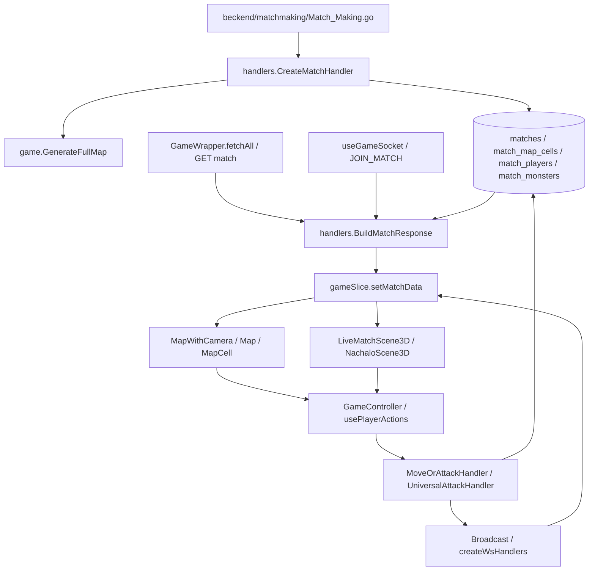

# NACHALO: аудит перехода на HEX

Дата: 18 октября 2026. Исходная ревизия: `9a462ad`. Аудит выполнен чтением репозитория; работающие сервисы и БД не опрашивались. Все описания «сейчас» относятся к коду этой ревизии, а не к подтверждённому состоянию развёрнутой игры. Изменения этого задания ограничены четырьмя документами. Планируемые решения находятся в [HEX_DESIGN.md](HEX_DESIGN.md), порядок работ — в [MIGRATION_PLAN.md](MIGRATION_PLAN.md), проверки — в [RISKS_AND_TESTS.md](RISKS_AND_TESTS.md).

## 1. Основные выводы

1. HEX затрагивает серверные правила и persisted state, а не только форму тайлов. `FullCell.X/Y`, `PlayerResponse.Position`, координаты монстров, JSON стартов/портала и WebSocket связаны одной квадратной моделью.
2. Фактический генератор — случайное заполнение квадратного поля. В `game/mapgen.go` нет выделенного генератора комнат и коридоров. Катакомбы дополнительно создаются визуально в `NachaloScene3D.tsx` и `catacombsAtmosphere.ts`.
3. Сервер принимает один целевой квадрат за запрос `/move`; Manhattan-соседство проверяется для обычного движения. До этой проверки занятая монстром/игроком клетка переводит запрос в атаку. Готовой атомарной команды маршрута нет.
4. Нет отдельного счётчика шагов за ход. Ограничители — энергия, активный игрок и таймер. Энергия общая для движения и атак и не обнуляется в конце хода.
5. Fog сейчас клиентский, в форме квадрата Chebyshev. Сервер выдаёт полную карту и игроков, поэтому скрытие спрайтов не обеспечивает секретность. LOS в проверке атаки отсутствует.
6. Самостоятельного AI перемещения монстров / A* не найдено в runtime-пути. Есть ответные атаки, состояние монстров, турели и принудительное перемещение от Ranger. Не следует описывать отсутствующий AI как существующую подсистему.
7. Матчи переживают рестарт благодаря PostgreSQL, но восстановление памяти неполное: очередь/активный игрок/номер круга восстанавливаются, временные боевые эффекты, события урона/убийств и таймеры — не этим механизмом.

## 2. Потоки вызовов и данные

Все backend-пути ниже находятся в реальном каталоге `beckend/` (именно такое написание в репозитории).

| Подсистема | Файл, реальные символы | Данные и вызовы |
|---|---|---|
| Создание матча | `beckend/matchmaking/Match_Making.go`; `beckend/gameservice/handlers/match.go`: `CreateMatchHandler`, `normalizeMatchPlan`, `buildTurnOrderFromTeams`, `mapStartPositionsToPlayers`, `assignMatchPlayers`, `insertMatchMonsters` | Matchmaking отправляет состав матча; handler нормализует команды, вызывает генератор, сохраняет строки матча/клеток/монстров/игроков и вызывает `game.CreateMatchState`. Очередь чередует команды; HEX не должен менять это правило. |
| Генерация / спавн | `beckend/gameservice/game/mapgen.go`: `MapConfig`, `FullCell`, `GenerateFullMap`, `collectCandidates`, `generateRandomPositions`, `generateRandomTeamClusters`, `dist2`, `isReachable`, `portalReachable`, `reachableFromPortal` | `[][]int`, `[2]int{x,y}`, построчные `cell_id`. `CreateMatchHandler`: walkable=.8, monster=.05, barrel=.1, resource=.1. Предметы размещаются только в компоненте портала. Все проходимые клетки не обязательно связаны; минимальное расстояние стартов не гарантировано. |
| Формат API | `beckend/gameservice/game/mapgen.go`: `FullCell`, `MonsterData`, `ResourceData`; `models/player.go`: `PlayerResponse`; `models/match.go`: `MatchInfo`; `handlers/match.go`: `MatchResponse`, `BuildMatchResponse` | Клетки `x/y`, игрок `position.x/y`, старты `[[x,y]]`, портал `[x,y]`, ширина/высота. `BuildMatchResponse` загружает полную карту и всех игроков; используется GET и WS JOIN. |
| Хранение | `beckend/gameservice/repository/match_map_cells.go`: `CreateMatchMapCellsTable`, `EnsureMatchMapCellsBackfilled`, `LoadMapCell`, `LoadMapCellForUpdateTx`, `SaveMapCell`, `SaveMapCellTx`, `InsertMatchMapCells`; `repository/matches.go`: `LoadMapCells`, `SaveMapCells` | `match_map_cells`, PK `(instance_id,cell_id)`, unique `(instance_id,x,y)`. Ресурс/бочка/монстр — JSONB. Старое `matches.map` backfill-ится, если строк клеток ещё нет. Новые матчи записывают `matches.map=[]`. |
| Позиции / коллизии | `repository/matches.go`: `CreateMatchPlayerCopy`, `GetMatchPlayerByID`, `UpdateMatchPlayer`, `UpdateCellPlayerFlags`, `ClearCellPlayerFlag`; `repository/players.go`: `CollisionCount`, `GetOtherPlayerID`; `repository/match_monsters.go`: `GetMatchMonsterAt`, `UpdateMatchMonsterPosition` | Позиция игрока, флаг клетки и строка монстра — отдельные представления одной занятости. Изменение позиции и флагов при обычном движении не объединено в одну транзакцию. |
| Движение / препятствия | `handlers/combat.go`: `MoveOrAttackHandler`, `cellPassable`, `baseMoveEnergyCost`, `resolveMoveEnergyCostFromPlayers`, `enemyGuardianAuraSourcesAtPosition`, `resolveGuardianAuraExitDamage` | Роуты подключает `cmd/main.go`. Проверки auth, active user, прямоугольные границы, monster/player, tile, structure, Manhattan=1, energy. Строение занимает клетку и может атаковаться через `/move`. Стены между клетками отдельными данными не представлены. |
| Очередь / время | `game/state.go`: `MatchState`; `game/match.go`: `CreateMatchState`, `EndTurn`, `RemovePlayerFromTurnOrder`, `AdvanceTurnCombatState`; `handlers/turn.go`: `EndTurnHandler`, `doEndTurn`, `startTurnTimer`, `regenEnergyForNextPlayer` | `TurnOrder`, `ActiveUserID`, `TurnNumber`; глобальная карта памяти. `doEndTurn`: стройка, турели, артефакты, смена игрока, regen, DB, WS, следующий таймер. Таймер и действия должны войти в единую сериализацию при маршрутах. |
| Бой | `handlers/combat.go`: `AttackRequest`, `UniversalAttackHandler`, `universalAttackLocked`, `loadStats`, `resolveAttackMode`, `doCounterattackWithEnergy`, `saveTargetHealth` | `stats.X/Y`, Manhattan; distance<=1 считается melee (включая overlap=0), ranged при `IsRanged` и distance<=range. Проверяются энергия и friendly fire; LOS и видимость цели здесь не проверяются. Запрос с `attacker_type=monster` требует отдельного ограничения доступа: проверка JWT игрока находится в ветке `player`. |
| Эффекты классов | тот же `combat.go`: `tryApplyRangerCriticalShot`, `tryPushCombatTarget`, `resolveRangerPushFallbackDamage`, `grantRangerThirdShotEnergy`, `tryApplyBerserkerBloodFeast`, `tryApplyMysticEnergyDrain`, `resolveGuardianShieldBlock`; `game/match.go` | Ranger: critical, armor break, третий выстрел/push/refund. Guardian: aura, exit damage, shield/free counter. Berserker: bonus/fury/lifesteal. Mystic: drain/overburn, особая защита монстра. Геометрия меняет применимость, не должна незаметно менять формулы. |
| Монстры | `game/monsters.go`: `InitMonstersFromCells`; `repository/match_monsters.go`; `handlers/combat.go`: `handleMonsterDeath`, `updateMonsterCellHealth`, `clearMonsterCell` | `MonsterState` в памяти и `MatchMonster` в БД; `InitMonstersFromCells` определён, но его runtime-вызов в исследованном дереве не найден. Speed/Vision не доказывают наличие AI. Реальное перемещение — `tryPushCombatTarget`. |
| Постройки | `handlers/blueprint_building.go`: `PlaceBlueprintHandler`, `manhattan`, `isBuildableOrdinaryCell`; `handlers/turn.go`: `progressConstructionByTurn`, `progressStructuresEffectsByTurn`, `applyTurretDamageToPlayer`, `applyTurretDamageToMonster` | Строить только в Manhattan-соседней обычной клетке. wall/scout_tower/turret — объекты клеток, не edge walls. Турель имеет Euclidean radius=2 через квадрат расстояния; после завершения scout tower меняет sight владельца. |
| Сбор / бочки | `handlers/resource_collection.go`: `CollectResourceHandler`, `UpdatedCellResponse`; `handlers/barrel_http.go`: `OpenBarrelHandler`; `handlers/barrel.go`: `HandleOpenBarrel`, `serialiseUpdatedCell`; `game/mapgen.go`: `OpenBarbel` | Команды `cell_x/cell_y`, auth/turn; collect использует блокировку клетки `FOR UPDATE`. Проверки нахождения игрока на клетке/рядом с ней отсутствуют в этих путях. Клиент сначала двигается, затем собирает/открывает; это не серверная гарантия. |
| Артефакты / свитки | `handlers/artifact_effects.go`: `artifactMoveCostBonus`, `markArtifactMoveUsed`, `applyEndTurnArtifactEffect`; `handlers/scrolls.go`: `UseScrollHandler` | Первый шаг Boots=-1, Titan=+2; turn-local состояние в `sync.Map`. Свитки раскрывают одну ось портала или ближайшего игрока, выбираемого Euclidean distance. Это разрешённая игровая разведка, её нужно явно специфицировать для q/r. |
| Портал / финал | `handlers/finish_match_handler.go`: `FinishMatchHandler`; `handlers/combat.go`: `transferQuestArtifact`, `handlePlayerDeath`; `service/match_service.go`: `FinalizeMatch`, `BuildMatchEndedPayload` | Сервер проверяет наличие квестового артефакта, затем фиксирует победителя/статистику; проверка равенства позиции порталу в `FinishMatchHandler` отсутствует. `FinalizeMatch` синхронизирует инвентарь/награды/опыт/историю, удаляет runtime-матч. |
| Восстановление / история | `repository/db.go`: `RestoreRuntimeState`, `RestoreMatchStates`, `GetMatchResults`, `EnsureMatchStatsRetentionSchema`; `repository/matches.go`: `UpdateMatchTurn`, `DeleteMatch`, `SaveMatchStats`, `SaveMatchPlayerStats`; `repository/match_history.go` | Из PostgreSQL восстанавливаются active/order/round. История и inventory snapshot сохраняются отдельно от runtime-клеток. Полноценный replay/event store не найден. CombatSequence и эффекты живут в памяти. |
| WS / reconnect | `handlers/ws_handler.go`: `WsHandler`, `Broadcast`, `scheduleReconnectGrace`; `src/hooks/useGameSocket.ts`: `useGameSocket`; `src/features/game/createWsHandlers.ts`: `createWsHandlers`, `selectActorSnapshot` | JOIN даёт `MATCH_UPDATE`, затем `MOVE_PLAYER`, `UPDATE_CELL`, `UPDATE_PLAYER`, `COMBAT_EXCHANGE`, смену хода, поражение, финал. Broadcast ограничивает матч, но не видимость конкретного получателя. Grace=3 минуты; истечение вызывает смерть. |
| Redux / загрузка | `src/features/game/GameWrapper.tsx`: `fetchAll`; `src/store/slices/gameSlice.ts`: `setMatchData`, `updateCell`, `movePlayer`, `updatePlayer`, `applyCombatExchangeState`; `src/store/slices/combatPresentationSlice.ts` | HTTP и WS имеют разные формы `snake_case/camelCase`. Combat queue хранит снимки актёров до обновления HP. В `gameSlice` эвристика защиты от profile update с position=(0,0); в axial (0,0) — нормальная клетка, эту эвристику нельзя переносить без явного типа события. |
| Управление | `src/components/GameController.tsx`: `handleMapCellClick`, `handleMapPlayerClick`; `src/hooks/usePlayerActions.ts`: `usePlayerActions`, `movePlayer`, `handleMoveOrAttack`, `handleCellClick`, `getDistance`, `canAttackAtDistance`; `src/hooks/useGameKeyboard.ts`; `src/components/Controls.tsx` | Два уровня Manhattan-проверок. Клик сейчас немедленно двигает/атакует; hook дополнительно собирает/открывает после движения. Четыре направления в `Dir`/`MoveDirection`/`DELTAS` и кнопках. |
| Classic | `src/components/MapWithCamera.tsx`: `MapWithCamera`, `buildVisibleWindowCells`, `PlayerLayer`, `resolveActiveSpritePose`, `CombatEffectsLayer`; `src/components/Map.tsx`: `Map`, `getCellAt`, `getTileBackground`; `src/components/MapCell.tsx`; `src/styles/Map.module.css` | Row-major индекс, square step=`tileSize+gap`, прямоугольное окно, pixel offsets, четыре направления спрайтов. Движение анимируется по смене серверной позиции, `STEP_ANIM_MS=260`. |
| Fog / minimap / цель | `src/utils/fogOfWar.ts`: `getCellIndex`, `collectVisibleCellIndices`, `buildExplorationStorageKey`, `loadExploredCells`, `persistExploredCells`; `src/components/MiniMap.tsx`: `resolveCellState`, `handleCellClick`; `src/components/ObjectiveTracker.tsx`: `manhattanDistance` | Team union квадратов видимости без LOS; exploration в sessionStorage как индексы `y*width+x`. Minimap клик фокусирует/пингует, не двигает. ObjectiveTracker показывает Manhattan расстояние до портала. |
| 3D / fog adapter | `src/components/LiveMatchScene3D.tsx`: `LiveMatchScene3D`, `seedFromInstance`; `src/utils/realMapAdapter.ts`: `adaptRealMap`, `isWalkableTile` | Adapter требует ровно width*height клеток, неизвестные превращает в препятствия, скрывает dynamic objects. Live хранит первую полную карту в `terrainRef`, передаёт `renderAllTerrain`; визуальный seed от instance ID не является seed генерации сервера. |
| 3D геометрия / камера | `src/components/NachaloScene3D.tsx`: `NachaloScene3D`, `wallShape`, `makeWorldUvBox`, локальные `onClick`, `addMesh`, RAF; `columnPlacement.ts`: `selectColumnCells`, `cellHash`; `catacombsAtmosphere.ts` | Мир `(x,0,y)`, квадратные box floors/стены, четырёхбитные N/E/S/W маски, cellIndex. OrthographicCamera, offset=(7,12,9), follow; picking Raycaster по видимым игрокам и floor meshes. Отдельного HEX world→cell нет. |
| Occlusion / анимации / эффекты | `wallOcclusion.ts`: `createWallOcclusionSampler`; `AnimatedRanger.ts`: `AnimatedRanger.setSpec`, `update`; `CombatOverlay3D.ts`: `CombatOverlay3D.update`; `useCombatPresentationPlayback.ts`: `useCombatPresentationPlayback`; `src/types/combat.ts` | Пять screen-space лучей на цель, выбор перекрывающих стен ~30 Hz, плавное fading до .2. Ranger world target=(x,y), скорость 2.75 world units/s, heading atan2; projectile/hit/death используют сырые cell x/y как world/pixel позиции. |
| Инструменты / тесты | `src/app/graphics-lab/page.tsx`, fixtures; `scripts/test_ranger_lab.mjs`, `test_ranger_combat.mjs`, `check_ranger_*`; `beckend/gameservice/game/*_test.go`, `handlers/*_test.go`, `repository/integration_*_test.go`; `beckend/matchmaking/Match_Making_test.go` | Graphics lab — fixture preview, не симулятор матча. Browser/live scripts могут выполнять реальные действия; не запускались. Отдельной административной HEX-карты/редактора не найдено. Существующие служебные API ресурсов/монстров подключены в `cmd/main.go`. |

## 3. Экономика действий: фактические значения

`handlers/combat.go:608`, `baseMoveEnergyCost`: mobility<=2 → 4; <=5 → 3; <=8 → 2; иначе 1. Вражеская аура Guardian добавляет 1 к шагу, если исходная позиция в радиусе 2; несколько аур не суммируют надбавку. На добровольном выходе накопленная надбавка наносит до 5 урона. Принудительный выход сбрасывает давление без такого урона.

`artifactMoveCostBonus`: Boots of Stealth уменьшают стоимость первого шага круга на 1, Titan Breastplate добавляет 2; итог минимум 1. Это означает, что стоимость маршрута зависит от состояния, а не только длины. Многошаговый путь может убить игрока на выходе из ауры.

Melee=6 энергии, ranged=8, стандартная контратака=2; артефакты могут добавлять стоимость, Guardian counter особый. В шаблонах `handlers/players.go`: Guardian 90 энергии/mobility2 → до 22 обычных шагов с полного запаса; Berserker 100/mobility3 → 33; Ranger 105/mobility4 → 35; Mystic 125/mobility3 → 41. Это арифметические верхние оценки без боя/аур/артефактов, а не выделенные movement points. Диапазоны Ranger=2, Mystic=3. Реальные характеристики могут изменяться экипировкой/прогрессией; читать текущий `PlayerResponse`.

`regenEnergyForNextPlayer` начисляет regen с ограничением maxEnergy. Фиксированное «3 шага за ход» или перенос energy в отдельные AP без решения владельца был бы изменением геймплея.

## 4. Реестр квадратных зависимостей

Сложность: Н — локальная, С — несколько потребителей, В — контракт/сохранения/правила. Риск оценивается относительно миграции. Строки — ориентиры текущей ревизии; имена функций выше устойчивее номеров.

| Файл → функция/место | Текущая логика | HEX-замена | Сложность | Риск |
|---|---|---|---|---|
| `game/mapgen.go` → `GenerateFullMap` | 15×15 при 1/2 игроках, иначе (6N)²; border; [][]int; row IDs | Конечное множество axial cells, профиль размера, устойчивые ID | В | Потеря темпа и размера карты |
| тот же → `isReachable`, `reachableFromPortal` | dirs=(±1,0),(0,±1), rectangular visited | Шесть соседей, edge blocking, map membership | С | Запертые цели |
| тот же → `dist2`, team clusters | dx²+dy², геометрически близкие центры | HEX distance для формы, graph distance для справедливости | С | Команды разделены стенами |
| тот же → tile literals | '1','0',' ', 'P','p','M','R','B'; числа 49/48/32/80/112/77/82/66 | Отдельные terrain/occupant/edge; versioned legacy decoder | В | Предмет превращается в стену |
| `handlers/combat.go:172` → `MoveOrAttackHandler` | new_pos_x/y, rectangle, Manhattan=1; occupied→attack | q/r, членство cells, CanTraverse; отдельный move intent | В | Неожиданная атака / обход энергии |
| тот же → `cellPassable` | Код тайла определяет проходимость | Terrain + edge + структура + занятость | С | Renderer/server расходятся |
| тот же → `resolveAttackMode`, `manhattanDistance` | Manhattan<=1 / attack_range, LOS отсутствует | HEX distance + visibility + edge/cell LOS | В | Стрельба через стены |
| тот же → `enemyGuardianAuraSourcesAtPosition` | Manhattan радиус 2 | HEX disk radius 2; политика ауры через стены явно | В | Изменение zoning / скрытая информация |
| тот же → Ranger push в `universalAttackLocked` (~2190) | sign(dx),sign(dy), возможен square diagonal | Один из шести векторов по направлению выстрела; проверка edge | В | Push через стену/на две HEX-дистанции |
| тот же → `tryPushCombatTarget`, `findCellIndex` | Lookup x/y, отдельные player/monster/cell updates | Axial lookup, атомарное обновление occupancy | В | Дубли монстра, потеря предметов |
| тот же → `transferQuestArtifact`, death/drop | Координаты смерти/дропа x/y | Версионированная позиция; сохранить ID предмета/жертвы | С | Потеря квестового артефакта |
| `handlers/blueprint_building.go:43` → `manhattan`, `PlaceBlueprintHandler` | Четыре клетки для строительства | Шесть, сохранение cell-wall как объекта | С | Путаница wall structure / edge wall |
| `handlers/turn.go:188` → `progressStructuresEffectsByTurn` | dx²+dy²<=2² для турелей | HEX range + LOS, отдельное утверждение баланса | В | Турель стреляет через стену |
| `handlers/scrolls.go` → `UseScrollHandler` | sqrt(dx²+dy²), scroll_*_x/y | HEX nearest + q/r версии предмета/ответа | С | Непреднамеренное раскрытие координат |
| `handlers/resource_collection.go`, `barrel_http.go` → requests/responses | cell_x/y, ручная сериализация | q/r и единые правила дистанции взаимодействия | В | Удалённый сбор остаётся возможен |
| `handlers/finish_match_handler.go` → `FinishMatchHandler` | `[2]int` portal, нет server position check | Axial portal + живой/active/на портале под lock | В | Удалённое завершение матча |
| `repository/match_map_cells.go` → schema/load/save/backfill | x/y unique, старый matches.map JSON | Аддитивная версия + q/r/edges; backfill только square | В | Старый матч прочитан как HEX |
| `repository/matches.go`, `match_monsters.go`, `models/player.go`, `models/match.go` | Столбцы позиций, JSON start/portal, width/height | Axial persisted contract для всех носителей | В | Рассинхронизация БД |
| `repository/db.go:980` → `RestoreMatchStates` | Только turn fields в memory; геометрии нет | Restore версии, revision, боевых counters | В | Рестарт меняет правила/повторяет бонус |
| `src/types/GameTypes.ts`, `types/combat.ts`, `ApiTypes.ts` | Cell/player/effect/notification x/y; Dir 4 | Discriminated geometry DTO; HexCoord q/r | В | Смешение world и cell координат |
| `GameWrapper.tsx`, `createWsHandlers.ts`, `useGameSocket.ts` | Несколько форм snake/camel и old events | Один decoder/version gate, revision+dedup | В | Поздний HTTP перетирает WS |
| `gameSlice.ts:169` → merge position | Особая обработка (0,0), cell patches x/y | Typed player patch, никаких sentinel координат | В | Герой не попадает в центр HEX-карты |
| `GameController.tsx:699,731` → map click handlers | Дубли Manhattan; немедленное действие | Единый interaction state machine | В | Обход подтверждения через 3D/player click |
| `usePlayerActions.ts:389,434` → movement/click/getDistance | DELTAS4, Manhattan, move→auto collect/barrel | Шесть направлений, pure preview, отдельный commit | В | Опасная цепочка запросов |
| `useGameKeyboard.ts`, `Controls.tsx`, `GameTypes.Dir` | up/down/left/right, стрелки | 6 направлений + подписи экранных векторов | С | Два keydown listener / не то направление |
| `Map.tsx` → `getCellAt`, `Map` | y*width+x, width*tile, square CSS | Map key→cell; HEX layout/shape/hit region | В | Видимый угол кликает соседнюю клетку |
| `MapWithCamera.tsx:266,270` → window/index | Прямоугольные окна и border clamps | Culling по world bounds axial cells | В | Пропавшие клетки на краю |
| тот же → `PlayerLayer`, `resolveActiveSpritePose`, `CombatEffectsLayer` | x/y*step, 4 sprite facings, 260ms step | Project endpoints, screen facing, queued confirmed segments | В | Герой режет углы / projectile мимо |
| `fogOfWar.ts` → `collectVisibleCellIndices`, index/storage | Квадрат min/max x/y без стен; `y*width+x`; size-key | Server visibility; stable IDs, geometry/mapRevision в key | В | Старый fog раскрывает новые клетки |
| `MiniMap.tsx` → `resolveCellState`, viewport/markers | Row-major, rectangular viewport и CSS grid | Та же axial проекция, camera footprint polygon | С | Неверный пинг/граница камеры |
| `ObjectiveTracker.tsx:133` → `manhattanDistance` | Manhattan до портала | HEX lower bound либо known path cost с подписью | Н | Подсказка обещает путь через стену |
| `buildPlayerMap.ts`, `getPlayerInCell.ts`, `usePlayerInCell.ts` | String keys и equality x/y | Единый coordKey(q,r), ID occupancy | Н | Коллизия ключей при отрицательных q/r |
| `realMapAdapter.ts` → `adaptRealMap` | width*height, nonnegative coords, dense array | Sparse cells + explicit unknown, index by stable ID | В | Adapter отклоняет валидную карту |
| `LiveMatchScene3D.tsx` → `terrainRef`, `renderAllTerrain` | Первый полный snapshot навсегда | Только разрешённая topology, patches mapRevision | В | Старая стена после открытия прохода |
| `NachaloScene3D.tsx:58` → `wallShape` | N=1,E=2,S=4,W=8, tee/cross/opposite | Шесть edge normals, canonical edge meshes | В | Угловые щели / двойные стены |
| тот же → `makeWorldUvBox`, floor, trims | Box 1×1, UV fract grid, осевые plinth/cornice | HEX prism/triangulated floor, UV по world, rotated edges | В | Швы материалов / несовпадение коллизий |
| тот же → camera/hero/object positions, onClick, visibility (~829,873) | Мир=(x,0,y); Math.round world; raycast meshes | Shared hexToWorld/worldToHex; IDs picking; projected bounds | В | Луч выбирает другой HEX |
| тот же → torch sort/spacing (~538), light distance (~746) | Manhattan tiles, direct world Vector3(x,0,y) | HEX spacing для cell правил, world metric для света | С | Неравномерный декор/освещение |
| `columnPlacement.ts` → `selectColumnCells` | 4 dirs, 3×3 neighborhood, x/y boundary, 2*dx | Шесть neighbors и known ring; сохранять препятствие | С | Декор выдаёт скрытую топологию |
| `catacombsAtmosphere.ts` + вызовы в scene | Декор/факелы в world x/z, ориентация wall faces | Передавать world transforms axial edges | С | Декор перекрывает проход |
| `wallOcclusion.ts` → sampler | Targets x/z и cellIndex; five rays | World projection и visibility IDs; edge ownership | С | Silhouette выдаёт скрытую цель |
| `AnimatedRanger.ts` → constructor/setSpec/update | Позиция=(x,0,y), atan2, 2.75 units/s | Convert before interpolation; одинаковая world длина шага | С | Скорость зависит от направления |
| `CombatOverlay3D.ts` → update, `useCombatPresentationPlayback.ts` | Cell x/y как world и нормализация dx/dy | Проекция snapshot endpoints; versioned effects | С | Стрелы/смерть на другой клетке |
| `utils/actionLog.ts`, `QuestArtifactAlert.tsx`, `ObjectHUD.tsx`, `toGameObject.ts` | Координатный текст x/y; rune-based terrain | q/r labels, redacted events, typed terrain | С | Координаты скрытого события в тексте |
| `graphics-lab/page.tsx`, `fixtures/game-15*.json`, `game-24.json` | Square fixtures, движение 4 dirs | Оставить явно square; добавить versioned HEX fixtures | С | Lab ошибочно принимается за live proof |
| `scripts/check_ranger_*.mjs`, `test_ranger_lab.mjs`, `test_ranger_combat.mjs` | dirs4, Manhattan/Chebyshev, hardcoded headings | Шесть направлений, LOS/visibility-aware navigation | С | Старые тесты проходят при неверном HEX |

Дополнительные CSS-потребители размеров: `src/styles/Map.module.css`, `MiniMap.module.css`, `Controls.module.css`, `GameController.module.css`; метрики камеры/viewport вычисляются также в `GameController.tsx`. Изменение только `MapCell` недостаточно.

## 5. Размеры, секретность и ограничения выводов

Счёт по существующим fixture-файлам (не статистика продакшена):

| Fixture | Всего клеток | Border | Obstacle | Остальные клетки, включая объекты/старты/портал |
|---|---:|---:|---:|---:|
| `src/app/graphics-lab/fixtures/game-15.json` | 225 | 56 | 37 | 132 |
| `src/app/graphics-lab/fixtures/game-15b.json` | 225 | 56 | 33 | 136 |
| `src/app/graphics-lab/fixtures/game-24.json` | 576 | 92 | 100 | 384 |

При .8 вероятности ожидание проходимых внутренних клеток для 15×15 равно 169×.8=135.2; это не гарантированное число связанных клеток. Для 24×24: 484×.8=387.2. Число реально доступных игроку зависит также от монстров/строений. Формула размера (6N)² растёт квадратично с N; её нельзя механически сохранять без профилирования.

`BuildMatchResponse` не принимает viewer ID. `WsHandler` JOIN задаёт instance из клиентского сообщения и вызывает этот builder; `Broadcast` фильтрует instance, не LOS. До строгой секретности требуется проверка участия на GET/JOIN, recipient projection для всех HTTP/WS и разрешённых разведсвитков. Данные из `gameSlice`, combat snapshots, action log, minimap, route preview нельзя считать безопасными только потому, что спрайт скрыт.

Не найдено сохранённого seed генерации: `GenerateFullMap` вызывает глобальный `rand.Seed(time.Now().UnixNano())`, а `SetRnd` используется для бочки, не для всей карты. Реальная воспроизводимость по seed сейчас не контракт. Семантика `rand.Seed` также зависит от версии Go/runtime; не использовать её как гарантию детерминизма. Replay не заменяется `COMBAT_EXCHANGE`: это presentation event с sequence в памяти, без полного журнала мира.

`FinishMatchHandler`, сбор и бочки требуют серверных пространственных проверок; это найденные пробелы текущей реализации, а не работы, выполненные этим аудитом. Полное сохранение поведения с одновременным закрытием таких пробелов требует явных тестов и согласования новых правил.
