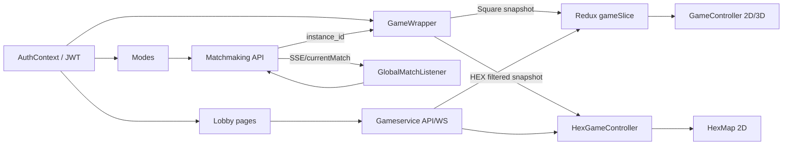

# UI Stage A — аудит архитектуры

Статический аудит 21.10.2026. Код приложения не менялся, браузер и сервисы не запускались. Статусы функций — в [01_FUNCTIONAL_INVENTORY.md](01_FUNCTIONAL_INVENTORY.md).

## Текущая схема

| Слой | Фактическое устройство | Критическая связь |
|---|---|---|
| Маршруты | Next.js App Router в `src/app`: `/profile`, `/matches`, `/matches/[instanceId]`, `/shop`, `/base`, `/equipment`, `/mode`, `/game`, `/game/stats`, auth; `/hex-lab` и `/graphics-lab` служебные | `/game` выбирает runtime по `instance_id`; ломать прямые URL нельзя. |
| Общий layout | `src/app/layout.tsx`: `AuthProvider`, ReduxProvider, `GlobalMatchListener`; `LobbyHeader` вставлен в каждую страницу Lobby | Глобальная подписка на matchmaking живёт вне Modes. |
| Доступ | `RequireAuth`, `AuthContext`; JWT из `localStorage`, проверка A `/auth/profile` | Страницы должны учитывать `isLoading`, истечение токена и отсутствие user. |
| Лобби | `ProfilePage`, `MatchHistoryPage/Details`, `LobbyShopPage`, `LobbyBasePage`, `EquipmentPage`, `ModeSelectionPage` | Почти каждый экран сам загружает данные, обрабатывает ошибки и рисует карточки. |
| Square runtime | `GameWrapper` → Redux `gameSlice`/`combatPresentationSlice`, `GameController`, `useGameSocket`, `createWsHandlers`, `usePlayerActions` | Square snapshot/patch и ревизии; 2D `MapWithCamera`, опциональная `LiveMatchScene3D`. |
| HEX runtime | `GameWrapper` → `HexGameController`, `useHexMatchSnapshot`, `HexMap`, `Inventory`, `HexMatchResults` | Личный filtered snapshot, q/r, `commandId`, `MATCH_PATCH`/`MATCH_HEX_VISUAL`. |
| Сервисы | auth A, matchmaking M, gameservice G; URL из `src/utils/serviceUrls.ts` | Разные владения данными: аккаунт, очередь/party, матч/экономика. |
| Реальное время | M SSE в `GlobalMatchListener`; G WS в Square и HEX hooks | Подписки, восстановление и dedupe различаются. |
| Постоянное состояние | PostgreSQL на backend: профиль, база, инвентарь, очередь, матч, история | React не источник наград, таймеров, видимости, стоимости или исхода боя. |

## Пять приоритетных проблем

1. **Монолитные страницы с запросами и представлением.** `ProfilePage.tsx` (~1500 строк), `ModeSelectionPage.tsx` (~1360), `GameController.tsx` (~1900), `EquipmentPage.tsx` (~900), `LobbyBasePage.tsx` и `LobbyShopPage.tsx` объединяют fetch, нормализацию, мутации, карточки и состояния загрузки. Изменения оформления легко задевают вызовы API. Сначала выделять границы данных и небольшие элементы, сохраняя существующие маршруты.
2. **Два источника перехода к найденному матчу.** `ModeSelectionPage` опрашивает M `currentMatch`/`inQueue`, а глобальный `GlobalMatchListener` слушает SSE и тоже вызывает `currentMatch`, держит свою `MatchReadyModal` и suppression в `localStorage`. Это не просто двойное отображение: независимые таймеры и состояние могут конкурировать при переходе. Нельзя выключать глобальный listener до проверки фонового сценария.
3. **Повторные запросы и локальные снимки одних данных.** Друзья: `ProfilePage.fetchFriends` и `ModeSelectionPage.fetchFriends`; герои: `LobbyBasePage.loadHeroes` и `ModeSelectionPage.fetchHeroes`; баланс и ресурсы: Shop (`/game/player/{id}`), Base (`/game/base/state`), Profile (`/game/profile`); экипировка: Shop и Inventory (`/game/equipment`). Повторное отображение оправдано, независимые правила обновления после мутаций создают риск устаревших чисел.
4. **Несколько путей игрового состояния и результатов.** `GameWrapper` сначала запрашивает Square `/game/match`, по 409 загружает HEX. Square использует Redux/WS/sessionStorage и `/game/stats`; HEX использует локальный snapshot/WS и `HexMatchResults`. `MatchHistoryDetailsPage` показывает третий вид результатов. Унификация визуальных блоков возможна только через адаптеры DTO, без смешения протоколов, личного тумана и источников наград.
5. **Презентация боевых событий связана с контроллерами.** `HexGameController` хранит action log, индикаторы, выбор и команды; Square `GameController` управляет HUD, `ActionLog`, overlay, 2D/3D сценами, keyboard и событиями. Для будущей замены поля нужен контракт «snapshot + intents + visual events»; расчёты боя, путь, туман и таймер остаются серверными.

## Другие подтверждённые дубли и ограничения

| Область | Свидетельство | Вывод для Stage B |
|---|---|---|
| Навигация | `LobbyHeader` встроен в шесть экранов; `/equipment` называется Inventory | Перенести общий shell в layout группы лобби, оставив маршрут и подпись. Проверить `/profile?id=`: внешний профиль сейчас скрывает header. |
| Карточки предметов | `EquipmentPage.InventoryCard`, `LobbyShopPage` shop/sell cards, `Inventory` для матча, `StorageLoadout` | Общие низкоуровневые визуальные части возможны; действия/DTO нельзя слить в один «предмет» без адаптера. |
| Статистика | `EquipmentPage.StatsComparison`, Profile, `MatchHistoryDetailsPage`, `/game/stats`, `HexMatchResults` | Единый `StatsSummary`/`MatchResultSummary` как представление, разные источники и права доступа. |
| Инвентарь | `StorageLoadout` в Base read-only и Modes editable; `Inventory` в Square/HEX; `EquipmentPage` — постоянная экипировка | Чётко назвать контексты: permanent equipment, pre-match loadout, match backpack. Не объединять серверные хранилища. |
| Уведомления | `GlobalMatchListener`, `ModeSelectionPage`, `createWsHandlers`, `useHexMatchSnapshot`, локальные errors/toasts | Единый визуальный NotificationCenter и типизированные события; источники SSE/WS остаются на своих границах. |
| Результаты | `HexMatchResults`, `/game/stats`, история | Переиспользовать сводки и карточки наград, но сохранять разные правила получения текущего и исторического результата. |
| Форматирование и локализация | HEX `src/i18n/hexGame.ts`, большинство Lobby строк прямо в JSX; CSS Modules и `globals.css` | Токены и общие состояния сначала; перенос текста по разделам без одномоментной смены всей локализации. |
| Dev и лаборатории | `NEXT_PUBLIC_EQUIPMENT_DEV_GRANT_ENABLED`, `/hex-lab`, `/graphics-lab` | Исключить из обычной навигации, сохранить флаги и тестовые пути. |

## Состояние и поток данных

`AuthContext` даёт identity/token, Redux хранит только состояние Square матча, React state хранит формы, локальные фильтры и HEX snapshot. `sessionStorage` в `/game/stats` используется для восстановления Square результата, `localStorage` — для auth и подавления повторной модалки матча. Перенос этих значений в один глобальный store без сценарных проверок может сломать refresh/reconnect.

## Проверки backend-контрактов

- `beckend/gameservice/cmd/main.go` регистрирует auth-защищённые Profile, Friends, Heroes, Base, Equipment, Storage, History, HEX endpoints. `beckend/matchmaking/Match_Making.go` содержит очередь, party и приглашения. Маршруты подтверждают связку, но не доказывают браузерную доступность.
- HEX действия в `src/components/HexGameController.tsx` отправляются в `/game/hex/{instanceId}/{route|move|attack-preview|attack|attack-structure|collect|open-barrel|use-item|place-blueprint|end-turn|extract}`. Их серверные последствия лежат в `beckend/gameservice/handlers` и `repository`, их нельзя пересчитывать в React.
- HEX видимость фильтруется `repository/hex_match.go`/`hex_fog.go`; `MATCH_HEX_VISUAL` фильтруется по получателю в `handlers/ws_handler.go`. Общая лента уведомлений не должна раскрывать координаты или инвентарь.
- Таймер HEX — `matches.hex_turn_deadline` и `handlers/hex_turn_timer.go`; подключение — `match_players.hex_disconnected_at` и `repository/hex_presence.go`. UI может показать оставшееся время, но не управлять дедлайном.
- Stage 9/9.1 хранит личные результаты (`hex_player_results`), историю и награды. Экран результата погибшего должен работать, пока матч продолжается для других; состояние `health`, участие в `turn_order` и WS-подключение различны.

## Что сохранить без изменения поведения

1. Шесть разделов Lobby, прямые URL, отдельный `/game` HUD и `/game/stats` для Square.
2. Все данные и действия F01–F94, включая доступные только в Square, а также служебные feature flags.
3. Проверку прав сервером, порядок действий партии и очереди, сохранение loadout до join.
4. Серверные цены, затраты ресурсов, ограничения слотов, награды, расчёт боя, таймеры и туман.
5. `commandId`, ревизии, idempotency, загрузку личного snapshot после WS patch, reconnect и восстановление результатов.
6. Разные контексты Inventory: постоянная экипировка, склад подготовки и рюкзак матча.

## Ограничения аудита

Статически не подтверждены реальные состояния в браузере и доступность БД/API в текущем развёртывании. Profile уже показывает общую и классовую статистику; при переносе полной сводки в History её нельзя потерять. Для зелёных комплектов Shop найден только отключённый UI; для Library research и Forge craft — описания/данные без завершённого пользовательского действия. Полное поведение Square 3D относительно 2D и реальные случаи конкурентных уведомлений требуют ручной проверки. Никаких ошибок в коде Stage A не исправляет.
